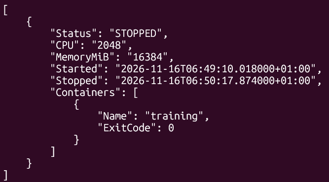
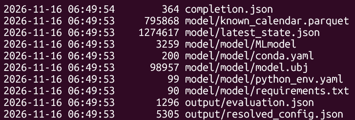
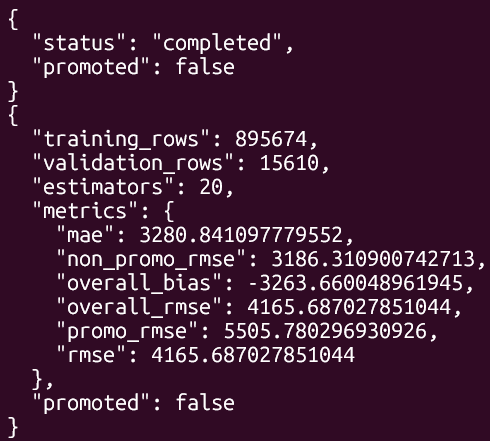

# AWS training

This project supports S3 storage and an isolated training container intended
for Amazon SageMaker AI training jobs.

## Validation status

Verified:

- Application tests with the AWS extra installed.
- S3 configuration and filesystem routing through unit tests.
- Conditional S3 release-pointer updates through unit tests.
- Local training with job-specific MLflow tracking.
- Exported model reload reproduces validation RMSE.
- Docker training with read-only input data.
- Terraform deployment of the AWS foundation.
- Training data upload to S3 and image upload to ECR.
- ECS/Fargate training using the S3 adapter and a non-root container user.
- Successful task termination with exit code zero.
- Candidate artifacts and completion marker uploaded to S3.
- Downloaded cloud model loaded successfully in the local environment.

Pending:

- Execution of the training container on SageMaker.
- Download and verification of SageMaker output artifacts.
- Integration with a shared MLflow registry and champion comparison.
- Automated AWS deployment workflows.

The training job exports a candidate. It does not register, promote, or
activate a serving release.

## Architecture

The AWS foundation contains:

- A private, versioned S3 bucket with server-side encryption.
- An ECR repository with immutable image tags.
- A SageMaker execution role scoped to training resources.
- The `/aws/sagemaker/TrainingJobs` CloudWatch log group with 14-day retention.

The intended training sequence is:

1. Upload `train.csv` and `store.csv` to S3.
2. Upload the training image to ECR.
3. Start a SageMaker training job using an explicit image digest.
4. SageMaker downloads the input channel to the training instance.
5. The container trains and evaluates a model using local files.
6. SageMaker uploads model and output artifacts to S3.

The configured job uses network isolation. The training code does not need
direct access to AWS APIs, a Prefect server, or an external MLflow server.

## Prerequisites

- Docker.
- uv and the project's supported Python version.
- Terraform compatible with `infrastructure/terraform-aws/versions.tf`.
- AWS CLI v2 with browser-based login support.
- An AWS account with access to S3, ECR, IAM, CloudWatch Logs, and SageMaker.
- A positive SageMaker training quota for the selected instance type and region.

Install the project's AWS dependencies:

```bash
uv sync --extra aws
```

## Configuration

The regular application loader supports:

| Variable | Purpose |
| --- | --- |
| `APP_ENV` | Selects the environment configuration. |
| `CLOUD_PROVIDER=aws` | Enables AWS storage-path mapping. |
| `S3_BUCKET_NAME` | Selects the S3 bucket for application paths. |
| `GCS_BUCKET_NAME` | Existing GCP bucket override. |

The isolated training entry point uses a separate configuration builder.
It reads model and feature settings from YAML, replaces runtime paths with
job-local paths, and does not load the project's `.env`.

SageMaker's input channel provides local files to the container.
`CLOUD_PROVIDER=aws` is therefore not required inside this training job.

## Local training

The required inputs are:

- `data/raw/train.csv`
- `data/raw/store.csv`

`test.csv` is not consumed by this training job. Validation is derived
chronologically from the labeled training observations.

Run a small functional test:

```bash
uv run --extra aws python -m mlops_sales_forecasting.aws.train \
  --input-dir data/raw \
  --work-dir artifacts/aws-training-smoke/work \
  --model-dir artifacts/aws-training-smoke/model \
  --output-dir artifacts/aws-training-smoke/output \
  --estimators 20
```

Work, model, and output directories must be empty or absent. Use a new
directory name for another run if previous results should be preserved.

The estimator override applies only to this run. Without `--estimators`,
the job uses the estimator count from the YAML configuration.

A 20-tree run checks execution and artifact handling; it is not a model
quality benchmark.

## Local container test

Build the image:

```bash
docker build \
  -f Dockerfile.training \
  -t mlops-sales-forecasting-training:local \
  .
```

Create separate output directories:

```bash
mkdir -p \
  artifacts/aws-container-smoke/work \
  artifacts/aws-container-smoke/model \
  artifacts/aws-container-smoke/output
```

Run with read-only inputs:

```bash
docker run --rm \
  --user "$(id -u):$(id -g)" \
  --workdir /opt/ml/work \
  --mount "type=bind,source=$(pwd)/data/raw,target=/opt/ml/input/data/training,readonly" \
  --mount "type=bind,source=$(pwd)/artifacts/aws-container-smoke/work,target=/opt/ml/work" \
  --mount "type=bind,source=$(pwd)/artifacts/aws-container-smoke/model,target=/opt/ml/model" \
  --mount "type=bind,source=$(pwd)/artifacts/aws-container-smoke/output,target=/opt/ml/output/data" \
  mlops-sales-forecasting-training:local \
  train \
  --config /app/configs/dev.yaml \
  --estimators 20
```

The container writes:

| Location | Contents |
| --- | --- |
| `/opt/ml/model/model/` | MLflow-format XGBoost model and signature. |
| `/opt/ml/model/latest_state.json` | Dated forecasting feature state. |
| `/opt/ml/model/known_calendar.parquet` | Known calendar features. |
| `/opt/ml/output/data/evaluation.json` | Metrics, parameters, and evaluation decision. |
| `/opt/ml/output/data/resolved_config.json` | Effective job configuration. |
| `/opt/ml/work/` | Intermediate features and job-local MLflow database. |

The job-local MLflow database is temporary tracking, not a shared registry.
SageMaker does not automatically preserve `/opt/ml/work`.

## Interpreting evaluation

`evaluation_approved` currently checks the configured minimum validation
and segment row counts. It does not establish improvement over a baseline
or an existing champion.

`promoted` remains `false`.

The exported XGBoost model produces predictions in the configured target
space. With `log1p`, apply the project's inverse target transformation to
obtain sales predictions.

The exported model directory, feature state, and calendar form candidate
artifacts. They are not an activated serving release.

## AWS authentication

For the development setup, use a named profile and browser login:

```bash
aws configure set region eu-north-1 --profile mlops-dev
aws configure set output json --profile mlops-dev

aws login --profile mlops-dev --remote
```

Select the intended project in the browser and complete the CLI prompt.

Check the active account:

```bash
aws sts get-caller-identity --profile mlops-dev
```

Configure a CLI credential-process profile for Terraform:

```bash
aws configure set credential_process \
  "aws configure export-credentials --profile mlops-dev --format process" \
  --profile mlops-terraform

aws configure set region eu-north-1 --profile mlops-terraform
```

These profiles use temporary credentials. Do not commit credential files
or authorization codes.

## Terraform foundation

Run commands from the repository root:

```bash
terraform -chdir=infrastructure/terraform-aws fmt -check
terraform -chdir=infrastructure/terraform-aws init
terraform -chdir=infrastructure/terraform-aws validate
```

Determine the expected account:

```bash
AWS_ACCOUNT_ID=$(aws sts get-caller-identity \
  --profile mlops-dev \
  --query Account \
  --output text)
```

Create and inspect a plan:

```bash
AWS_PROFILE=mlops-terraform \
terraform -chdir=infrastructure/terraform-aws plan \
  -var="aws_account_id=$AWS_ACCOUNT_ID" \
  -out=aws-foundation.tfplan
```

Apply the reviewed plan:

```bash
AWS_PROFILE=mlops-terraform \
terraform -chdir=infrastructure/terraform-aws apply \
  aws-foundation.tfplan
```

Read the resulting addresses:

```bash
terraform -chdir=infrastructure/terraform-aws output
```

The initial setup uses local Terraform state. Preserve this state outside
Git. It is needed to manage the existing resources.

Commit `.terraform.lock.hcl`. Do not commit `.terraform/`, state files,
saved plans, or local variable files.

## Data and image uploads

Select the profile:

```bash
export AWS_PROFILE=mlops-dev
export AWS_REGION=eu-north-1
export AWS_PAGER=""
```

Read resource addresses from the existing Terraform state:

```bash
TRAINING_INPUT_URI=$(terraform -chdir=infrastructure/terraform-aws output -raw training_input_uri)
TRAINING_REPOSITORY=$(terraform -chdir=infrastructure/terraform-aws output -raw training_repository_url)
ECR_REGISTRY="${TRAINING_REPOSITORY%%/*}"
```

Upload a named input snapshot:

```bash
aws s3 cp data/raw/train.csv "$TRAINING_INPUT_URI/rossmann-v1/train.csv"
aws s3 cp data/raw/store.csv "$TRAINING_INPUT_URI/rossmann-v1/store.csv"
aws s3 ls "$TRAINING_INPUT_URI/rossmann-v1/"
```

Use a new input prefix when the dataset changes.

For Docker Desktop credential-helper failures under WSL, use a temporary
Docker configuration:

```bash
TRAINING_DOCKER_CONFIG=$(mktemp -d)

aws ecr get-login-password --region eu-north-1 |
  docker --config "$TRAINING_DOCKER_CONFIG" login \
    --username AWS \
    --password-stdin "$ECR_REGISTRY"
```

Tag and push the tested image:

```bash
TRAINING_IMAGE_TAG="smoke-$(git rev-parse --short HEAD)-$(date -u +%Y%m%dT%H%M%SZ)"
TRAINING_IMAGE_URI="$TRAINING_REPOSITORY:$TRAINING_IMAGE_TAG"

docker --config "$TRAINING_DOCKER_CONFIG" tag \
  mlops-sales-forecasting-training:local \
  "$TRAINING_IMAGE_URI"

docker --config "$TRAINING_DOCKER_CONFIG" push "$TRAINING_IMAGE_URI"
```

The tag does not prove which source revision an existing local image
contains. Rebuild and retest after changing training code.

After a successful upload, remove temporary credentials:

```bash
rm -f -- "$TRAINING_DOCKER_CONFIG/config.json"
rmdir -- "$TRAINING_DOCKER_CONFIG"
unset TRAINING_DOCKER_CONFIG
```

## SageMaker quota

The current smoke job requires one `ml.m5.xlarge` training instance in
`eu-north-1`.

Check the applied quota:

```bash
aws service-quotas get-service-quota \
  --profile mlops-dev \
  --service-code sagemaker \
  --quota-code L-CCE2AFA6 \
  --region eu-north-1 \
  --query 'Quota.Value' \
  --output json
```

A value of zero prevents this training job from starting, regardless of
the available credit balance.

A quota-increase request does not start an instance. If a request opens
a support case, check that case for updates or information requests.

## Prepared cloud job

`configs/aws/training-smoke.json` contains the initial account-specific
job configuration.

It selects:

- One `ml.m5.xlarge` instance.
- A 20 GB training volume.
- A Linux/amd64 image by digest.
- The `rossmann-v1` input prefix.
- Twenty estimators for the functional test.
- A maximum runtime of 900 seconds.
- Network isolation.

Check JSON syntax:

```bash
python3 -m json.tool configs/aws/training-smoke.json > /dev/null
```

Before submission, verify the account, region, execution role, image
digest, S3 paths, and applied quota.

Training-job names must be unique. Choose a new name for subsequent jobs.

Cloud execution and output retrieval remain pending validation.

## Verified ECS/Fargate execution

The Fargate adapter is implemented in
`src/mlops_sales_forecasting/aws/fargate_train.py`.

It downloads `train.csv` and `store.csv`, invokes the shared training entry
point in a separate process, and uploads model and evaluation artifacts.

Each execution writes to a unique S3 prefix. A `completion.json` marker is
uploaded only after all artifact uploads succeed. Partial uploads without
this marker must not be treated as completed runs.

Terraform provisions a standalone task with:

- 2 vCPUs and 16 GB memory.
- A Linux/amd64 training image pinned by digest.
- Container user `10001:10001`.
- Separate execution and application task roles.
- No inbound security-group rules and outbound HTTPS access.
- A public subnet and a public IP assigned at task launch.
- CloudWatch container logs with 14-day retention.

The task is started explicitly; no continuously running ECS service is
created. The container filesystem remains writable for temporary files.

The training subprocess has a 900-second timeout. This does not impose a
timeout on the entire task, including data transfers.

Outbound TCP/443 is allowed to any IPv4 destination so the task can access
public AWS endpoints. This does not restrict destinations to AWS services.
The rule has a resource-scoped Trivy exception for the development setup.
Consider private VPC endpoints and tighter egress controls for production
or confidential workloads.

### Cloud smoke-test result

Verified on 2026-11-16:

| Check | Result |
| --- | --- |
| ECS task exit code | 0 |
| Training rows | 895,674 |
| Validation rows | 15,610 |
| Estimators | 20 |
| Validation RMSE | 4165.687028 |
| Exported model features | 37 |
| Stores in exported state | 1,115 |
| Completion marker in S3 | Present |
| Downloaded model loads locally | Passed |
| Model promotion | Not performed |

### Execution evidence

The Fargate task completed successfully with exit code zero.
CPU `2048` corresponds to 2 vCPUs; memory was configured as 16 GiB.



Model artifacts, evaluation output, and the completion marker were
uploaded to S3.



The 20-tree smoke test confirms cloud execution and artifact handling.
These metrics are not a production model-quality benchmark.
No model promotion was performed.



This small training run verifies execution and artifact handling.
It does not establish production model quality or improvement over a baseline.

SageMaker uses the shared training entry point directly and remains
available as a separately configured execution option.

## Costs and cleanup

The foundation creates no running training instance or inference endpoint.
Stored S3 objects, ECR images, logs, and training execution can consume
credits or incur charges according to the account plan.

The runtime limit is not a monetary spending cap.

The Terraform configuration deliberately disables forced deletion of
non-empty S3 buckets and ECR repositories.

To remove the environment:

1. Stop any active training jobs.
2. Download results that must be retained.
3. Review a Terraform destroy plan.
4. Explicitly remove disposable ECR images and all disposable S3 object
   versions and delete markers.
5. Apply the reviewed destroy plan.

An ordinary deletion from a versioned S3 bucket can leave previous object
versions stored. Do not discard Terraform state before cleanup is complete.