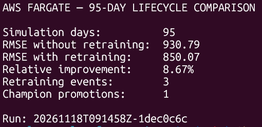
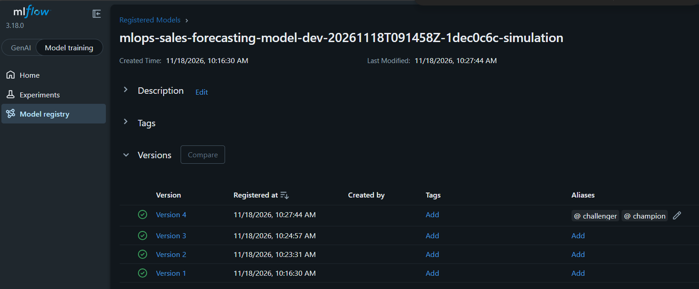
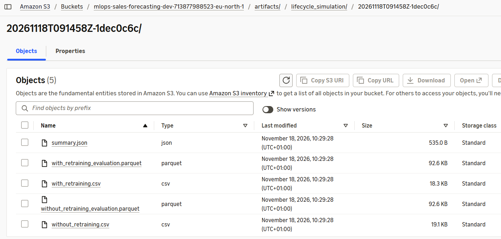
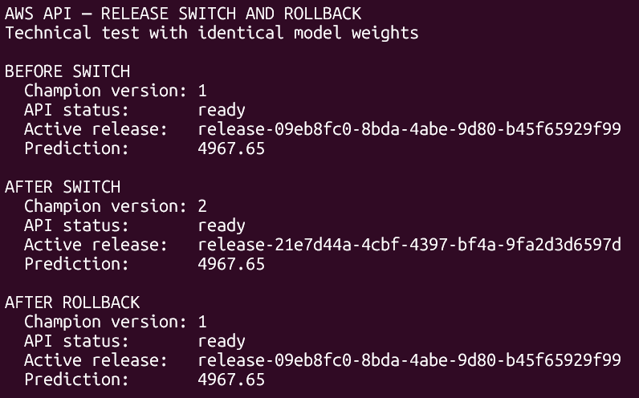
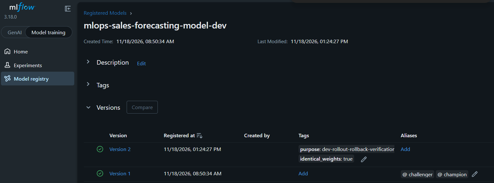
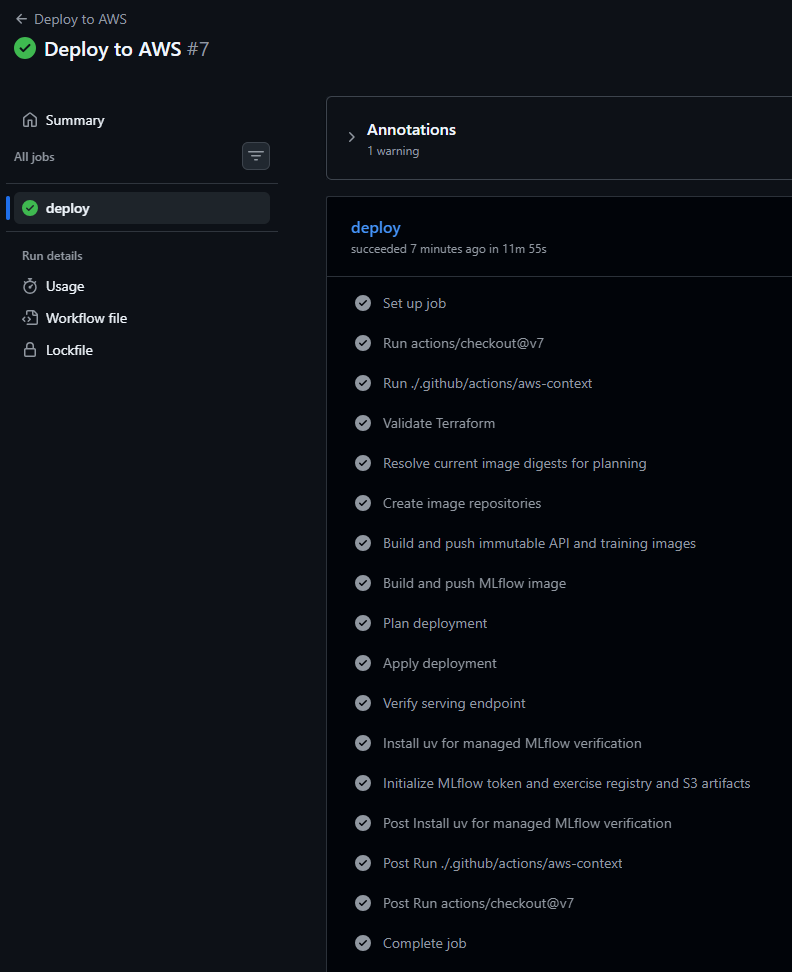
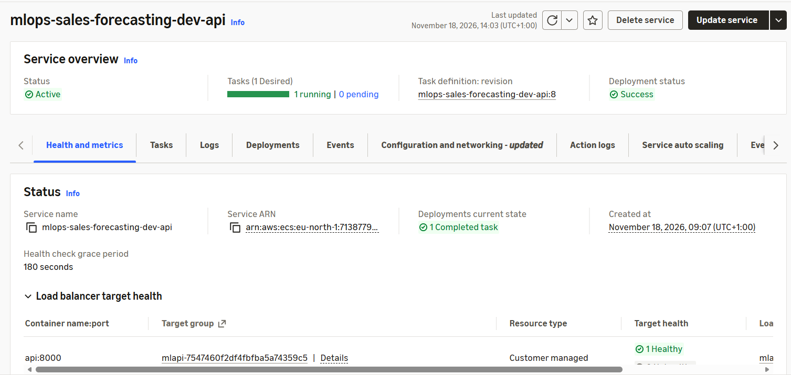
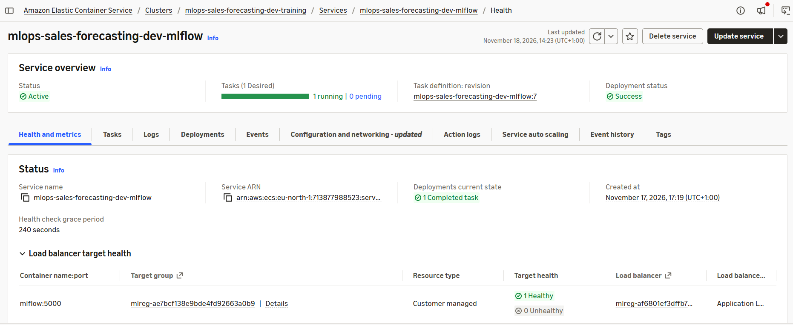
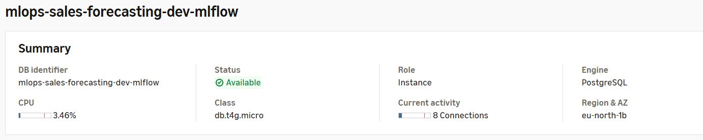

# AWS verification

Verified in the development environment in Stockholm (`eu-north-1`) on
November 18, 2026. Screenshots capture that test state rather than a guarantee
of continuous demo availability.

## 95-day lifecycle comparison

The existing simulator ran inside Fargate using S3 inputs and the shared AWS
MLflow service. Static and managed arms restored the same initial champion.
Cooldowns used simulation dates. The controlled scenario gradually reduced
sales on promotion days while keeping the promotion calendar unchanged.

| Measure | Static champion | Managed lifecycle |
| --- | ---: | ---: |
| Simulated days | 95 | 95 |
| Final-window RMSE | 930.79 | 850.07 |
| Retrainings | 0 | 3 |
| Champion promotions after bootstrap | 0 | 1 |

The managed arm improved final-window RMSE by **8.67%**, reproducing the
documented reference comparison. This is a controlled simulation result, not
a measured production business impact.

The simulation registered four versions; version 4 became champion. The
`challenger` alias also remained on version 4 because it identifies the latest
candidate. Aliases are independent pointers rather than exclusive states.

Simulation inputs were downloaded to the task's isolated workspace. Mutable
state, delayed labels, monitoring and model reloads ran there. Remote MLflow
kept model metadata/artifacts; the final CSV and Parquet reports were uploaded
to S3 under run `20261118T091458Z-1dec0c6c`. The simulation did not alter the live
API champion.

## Live API release switch and rollback

The reusable verification script and its operational instructions are documented
in [Dev API release-switch and rollback verification](aws-model-rollout-verification.md).

A separate technical test created a tagged duplicate of the initial registered
model with identical weights. It validated copied artifacts, activated the new
release, refreshed ECS and checked registry alignment, readiness and an
authenticated prediction. The existing rollback operation then restored the
original version and release, followed by the same checks.

| State | Champion version | Prediction |
| --- | ---: | ---: |
| Before switch | 1 | 4967.65 |
| After switch | 2 | 4967.65 |
| After rollback | 1 | 4967.65 |

The request used Store 1, April 28, 2015, open, with `Promo=1`.
Equal predictions are expected because this test reused identical weights.

Version 1 again carries `champion`; version 2 is retained with explicit
verification-purpose and identical-weight tags. No original model was deleted.

## Deployment and persistent services

GitHub Actions deployed through OIDC and Terraform. Deployment checks covered
API readiness, rejection of unauthenticated prediction requests, and managed
MLflow registry/S3 operations. Separate authenticated requests exercised real
forecasting inference. Deployment run: `44307524077`.

MLflow metadata is stored in RDS PostgreSQL and artifacts in S3. The persistence
workflow verified existing registry data and a model after MLflow task
replacement (run `44254984328`).

The MLflow UI initially caused a confirmed out-of-memory termination with
2 GiB RAM. Memory was increased to 4 GiB; the subsequent deployment and registry
access succeeded. No sustained-load or high-availability guarantee is implied.

## Verification limits

- Quality-driven retraining, promotion and model reload were verified inside
  the isolated simulation. Automatic live API refresh following such a new
  promotion has not been verified end to end.
- The live API switch and rollback used identical weights and a local
  verification script calling the existing release/ECS operations.
- Manual `auto-retrain` tasks refreshed monitoring and respected cooldown.
  Daily scheduled execution and application-image rollback remain unverified.
- Prefect used a temporary server inside each task. There is no persistent
  central Prefect server or retained central Prefect run history.
- Public ingress uses HTTPS; gateway-to-ALB-to-container traffic uses HTTP
  within the VPC. Shared bearer/API tokens are not multi-user authorization.

See [AWS lifecycle](aws-lifecycle.md), [simulation](aws-simulation.md),
[serving](aws-serving.md) and [MLflow operations](aws-mlflow.md).
